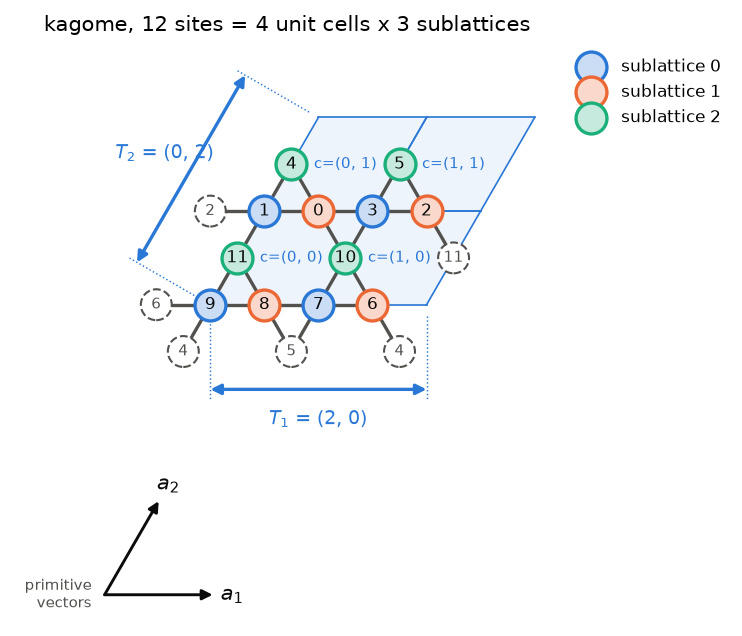
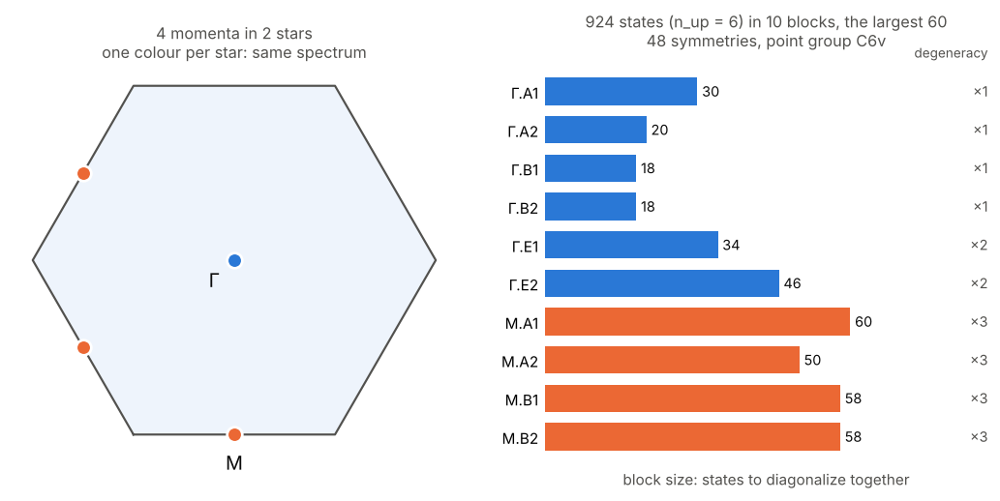
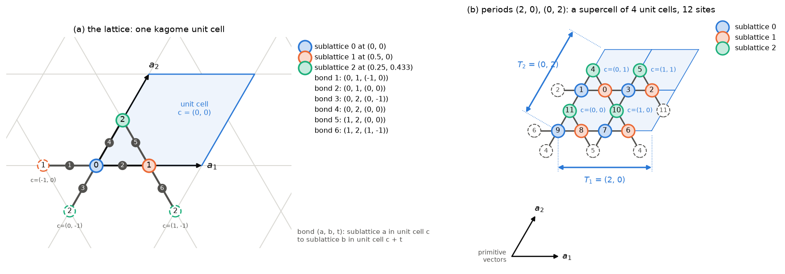
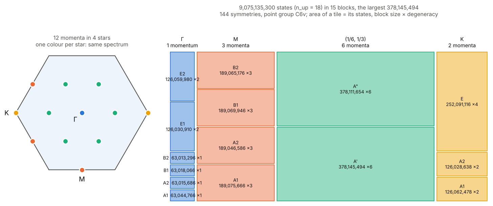
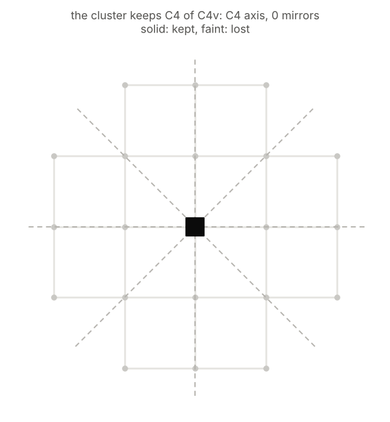

# clustercert

*Why I built this.* Exact-diagonalization papers specify their clusters as pictures, period vectors or edge lists, and an ED code only ever sees the edge list. I wanted a way to prove that a given edge list really is the periodic lattice it claims to be, with no misplaced or missing wrap-around bond, starting from the edge list alone.

Check that a finite graph, such as the bond list of an exact-diagonalization cluster, really is a periodic cluster of a lattice. A *yes* comes with a certificate you can check yourself; a *no* means no periodic boundary conditions can produce your graph.

## Quick start

Suppose someone hands you this 12-site bond list and says it is a kagome cluster with periodic boundary conditions:

```python
import clustercert as cc

edges = [(0, 1), (0, 3), (0, 4), (0, 10), (1, 2), (1, 4), (1, 11), (2, 3), (2, 5), (2, 11), (3, 5), (3, 10),
         (4, 6), (4, 9), (5, 7), (5, 8), (6, 7), (6, 9), (6, 10), (7, 8), (7, 10), (8, 9), (8, 11), (9, 11)]
result = cc.certify(edges, 'kagome')
print(cc.summary(result))
cc.plot(result, details=True)
```

```text
YES: periodic kagome cluster, periods [[2, 0], [0, 2]]
  periods (in primitive vectors -> Cartesian):
    (2, 0) -> (2, 0)
    (0, 2) -> (1, 1.732)
  site map, your label -> (unit cell, sublattice):
    0 -> (0, 1), 1
    1 -> (0, 1), 0
    ...
  4 allowed momenta (in reciprocal primitive vectors): (0, 0), (0, 1/2), (1/2, 0), (1/2, 1/2)
```



That is your cluster, drawn with your own labels. Each shaded tile is one unit cell of the kagome lattice, labelled with its coordinates c in units of the primitive vectors a₁ and a₂ (the arrows below). Each site is coloured by its sublattice, one of the three sites of a unit cell. So site 9 is sublattice 0 of unit cell (0, 0), exactly as the site map says. A bond that wraps around the boundary ends on a dashed circle labelled with the site it wraps to. The site map is the certificate: under it, your 24 bonds are exactly the kagome bonds folded by those periods.

The certificate also gives the cluster's symmetries, ready for exact diagonalization:

```python
sym = cc.symmetry(result)
print(sym.summary(n_up=6))
sym.plot(n_up=6)
```

```text
symmetry of the periodic kagome cluster, periods [[2, 0], [0, 2]]
  12 sites, 48 lattice symmetries = 4 translations x 12 point operations (point group C6v; the infinite lattice has C6v, 12 operations)
  every automorphism of the bond graph is a lattice symmetry
  point operations: E, C6 x2, C3 x2, C2, σ x6
  4 momenta in 2 stars, k in reciprocal primitive vectors:
    name  k         star  little co-group  irreps, (dimension) if not 1
    Γ     (0, 0)       1  C6v              A1 A2 B1 B2 E1(2) E2(2)
    M     (0, 1/2)     3  C2v              A1 A2 B1 B2
  block sizes (n_up = 6; each level is (star x dimension)-fold degenerate):
    Γ: A1 30, A2 20, B1 18, B2 18, E1 34, E2 46
    M: A1 60, A2 50, B1 58, B2 58
```



The cluster keeps the full hexagonal symmetry of kagome. Its 4 momenta form 2 *stars* (left: momenta of one colour have the same spectrum), and the operations that keep each momentum split it further into *irreps*. So the 924 states at zero magnetization split into 10 blocks of at most 60 (right), and each level in a block repeats as often as the number on the right. The permutations and characters behind each block are in `sym`; see [Symmetry sectors](#symmetry-sectors).

Now a second list. It also has 12 sites and 24 bonds, every site has 4 neighbours, and every site lies in two corner-sharing triangles, just as in kagome:

```python
impostor = [(0, 1), (0, 2), (0, 3), (0, 4), (1, 2), (1, 7), (1, 9), (2, 8), (2, 11), (3, 4), (3, 5), (3, 6),
            (4, 9), (4, 10), (5, 6), (5, 7), (5, 8), (6, 10), (6, 11), (7, 8), (7, 9), (8, 11), (9, 10), (10, 11)]
print(cc.summary(cc.certify(impostor, 'kagome')))
```

```text
NO: not a periodic kagome cluster: none of the 7 possible supercells of 4 unit cells matches
```

Every way of folding kagome into 12 sites was tried, and none gives this graph. Both lists are in [`examples/clusters/`](examples/clusters), so the same check runs from the shell: `clustercert examples/clusters/kagome_12.txt kagome`. Built-in lattices: square, triangular, honeycomb, kagome, checkerboard, cubic, bcc, fcc, diamond, pyrochlore.

The rest of this page explains what is going on, step by step. The tour notebook [`examples/tour.ipynb`](examples/tour.ipynb) follows the same path, with pictures.

## Install

```bash
cd clustercert
python -m venv .venv && source .venv/bin/activate
pip install -e ".[dev]"      # numpy and networkx, plus pytest, ruff and matplotlib (for plot)
pytest -q
```

## Why a certificate is needed

For a Hamiltonian on a graph, all an ED code knows is the list of bonds. A bond wrapped to the wrong site, a twisted boundary, an open edge, or a supercell so small that a bond closes onto itself: each still gives a perfectly good Hamiltonian, just not the one you meant. Counting neighbours does not catch these errors. On a 4×4 square torus, moving two wrap-around bonds keeps every site at four neighbours, but the graph is no longer a square lattice.

Even "looks right everywhere" is not enough, as the impostor above shows. Every site of the pyrochlore lattice sits in two corner-sharing tetrahedra. Take any graph where every vertex has four neighbours and there are no odd loops. Put a site on each of its edges, and join two sites when their edges meet. The result has the same local structure: six neighbours per site, two tetrahedra per site. Pyrochlore is the case where the starting graph is the diamond lattice. In general the result is not a pyrochlore cluster, and only a global check can tell.

## The idea: folding

A periodic cluster is the infinite lattice folded onto itself. Choose a set of translations Λ, the *periods*, and identify any two sites that differ by one of them. A torus of L₁ × L₂ unit cells has periods L₁**a**₁ and L₂**a**₂, but tilted supercells are allowed too.

The key fact is that, for a given number of sites, there are only finitely many ways to fold. With n sites per unit cell, a cluster of N sites has k = N/n unit cells, so Λ must contain exactly one in every k translations of the lattice. Each such Λ can be written in exactly one way as a triangular matrix of integers, its **Hermite normal form**. In two dimensions, the period rows are (d₁, x) and (0, d₂), with d₁d₂ = k and 0 ≤ x < d₂. For k = 4 this gives 7 choices. In three dimensions, there are 35 choices for k = 4 and 155 for k = 8.

So the check is a finite search:

1. List every possible Λ.
2. Fold the infinite lattice by each one. This uses integer rules only, with no coordinates.
3. Ask whether your graph is the same as the folded one up to relabelling sites. This is graph isomorphism. Cheap invariants rule out most candidates, and [networkx](https://networkx.org)'s VF2++ search handles the rest.

**Why you can trust the answer.** A *yes* comes with a label (unit cell, sublattice) for every site of your graph. Under these labels your bonds are *exactly* the bonds of the folded lattice, and this is checked bond by bond. You can verify it yourself without trusting the search. A *no* means that every possible Λ was tried and none fits. The proofs are in [`docs/METHOD.md`](docs/METHOD.md).

## What goes in: lattices, unit cells and clusters



This section defines precisely the terms used above.

**A lattice** is an infinite periodic lattice, described by what one unit cell contains. In code it is a `Lattice` object with these fields:

| Field         | Meaning                                                                                 | Kagome                         |
| ------------- | --------------------------------------------------------------------------------------- | ------------------------------ |
| `dim`       | dimension d                                                                             | 2                              |
| `vectors`   | primitive vectors **a**₁ … **a**_d (Cartesian, one per row)               | (1, 0), (1/2, √3/2)           |
| `n_basis`   | number n of sites per unit cell. They are called *sublattices* and numbered 0 … n−1 | 3                              |
| `positions` | Cartesian position of each sublattice in unit cell 0                                    | (0, 0), (1/2, 0), (1/4, √3/4) |
| `bonds`     | the bonds of one unit cell, each as `(a, b, t)`; see below                            | 6 bonds                        |

**Unit cells** are labelled by integer vectors c = (c₁, …, c_d), counted in primitive vectors. Unit cell c is the copy of unit cell 0 shifted by c₁**a**₁ + … + c_d**a**_d. **A site** of the infinite lattice is a pair (c, a): sublattice a in unit cell c.

**A bond** `(a, b, t)` means that sublattice a in unit cell c is bonded to sublattice b in unit cell c + t, for every c. The shift t is an integer vector. It is (0, 0) for a bond inside the unit cell, and nonzero for a bond that reaches into a neighbouring cell. Each bond of the lattice is listed once. In panel (a), bond `(0, 1, (-1, 0))` joins sublattice 0 to sublattice 1 one cell to the left.

The search uses only the integers `n_basis` and `bonds`. The geometry (`vectors`, `positions`) is optional; it is used only to report period vectors, positions and momenta, to draw, and to find further-neighbour shells. `cc.plot_lattice(cc.KAGOME)` draws one unit cell of any 2D lattice, as in panel (a), with every bond numbered and listed as `(a, b, t)`. `print(cc.KAGOME.describe())` gives the same in text:

```python
print(cc.KAGOME.describe())
# kagome: 2D, 3 sublattice(s) per unit cell, 6 bonds per unit cell
#   primitive vector a1 = (1, 0)
#   ...
#   bond (0, 1, (-1, 0)): sublattice 0 in unit cell c -- sublattice 1 in unit cell c + (-1, 0), length 0.5
```

**A cluster** is your input: a finite graph, given as a list of bonds between site labels. The labels can be anything (integers, strings), in any order, and carry no geometry. The question is whether this graph is a periodic piece of the lattice.

**Periods** describe the boundary conditions. They are d integer vectors T₁ … T_d, in units of the primitive vectors, and are given as the rows of an integer matrix. Two sites of the infinite lattice that differ by a combination of periods are the same site of the cluster. The periods span the **supercell**. It holds k = |det| unit cells, so the cluster has N = k·n sites. In panel (b), the periods (2, 0) and (0, 2) span 4 unit cells, which gives 12 sites. The same periods can be written in many bases; `cc.hnf(periods)` gives the one canonical form, used everywhere in the output.

**The result** of `certify` says whether some set of periods turns the lattice into exactly your graph. If so, it gives those periods and the **site map** `sites`, which assigns each of your site labels its (unit cell, sublattice). Under this map, your bonds are exactly the bonds of the folded lattice.

## What you get

- `periods`: the periods in canonical (Hermite normal) form, as integer rows in units of the primitive vectors. `period_vectors(periods, lattice)` turns it into a short basis, in both primitive and Cartesian coordinates.
- `sites`: the site map, giving each of your sites its (unit cell, sublattice) in the infinite lattice. `site_positions(result, lattice)` gives Cartesian positions. Use them to build translation operators.
- `plot(result)`: a drawing of the cluster with your site labels, its wrap-around bonds and its supercell, in 2D or 3D (needs matplotlib). `details=True` (2D) draws it in its unit cells instead, with sublattice colours and the primitive vectors, matching the site map. `further=` adds further-neighbour bond families, drawn dashed. `plot_lattice(lattice)` draws one unit cell of a lattice.
- `momenta(periods, lattice)`: the momenta allowed by the boundary conditions, with one per unit cell in the supercell. Use it to check which high-symmetry points your cluster contains.
- `symmetry(result)`: the symmetry sectors of the cluster, with the permutations and characters an ED code needs; see [Symmetry sectors](#symmetry-sectors).
- `reason`: a short explanation, including for failures. For example: `degrees [5, 6], but every pyrochlore site has [6] (sites with too few bonds: open boundary or a missing wrap-around bond?)`.

## One graph, several supercells

A graph can be the folding of more than one supercell. The 12-site kagome cluster arises from the 2×2 rhombus and also from a supercell with periods of lengths √3 and 2 (unit lattice constant). The 16-site pyrochlore cluster arises from the conventional cubic cell and also from three non-cubic supercells. For a nearest-neighbour model the graph is the Hamiltonian, so the spectrum does not depend on which supercell you pick. The momentum labels do, and so do any further-neighbour bonds (next section). `certify(..., find_all=True)` lists every matching Λ and keeps the most compact supercell. To use a different one, pass its periods to `momenta`.

```python
r16 = cc.certify(cc.read_edges('examples/clusters/pyrochlore_16.txt'), cc.PYROCHLORE, find_all=True)
len(r16['matching'])                                   # 4 supercells give this graph
rows, cartesian = cc.period_vectors(r16['periods'], cc.PYROCHLORE)
cartesian                                              # the cubic cell: (1,0,0), (0,1,0), (0,0,1) up to order
frac, k = cc.momenta(r16['periods'], cc.PYROCHLORE)    # Gamma and the three X points
```

## Further-neighbour bonds

With J₂, J₃, … the nearest-neighbour graph is no longer the whole Hamiltonian. Two things can then go wrong, and certifying the J₁ bonds alone catches neither:

- a J₂ bond in your list is wrapped to the wrong site;
- the supercell cannot host J₂ at all. Different supercells that give the same J₁ graph do not give the same J₂ bonds. In many of them, two J₂ bonds fold onto the same pair of sites, or a J₂ bond folds onto a J₁ bond.

| Cluster       | Supercells giving the J₁ graph | Supercells that also have clean J₂ bonds |
| ------------- | ------------------------------: | ----------------------------------------- |
| kagome 12     |                               4 | only the 2×2 rhombus                     |
| pyrochlore 16 |                               4 | none                                      |
| pyrochlore 32 |                              10 | only the 2×2×2 FCC supercell            |

So the 16-site pyrochlore cluster is fine for a nearest-neighbour model but has no well-defined J₁–J₂ model.

To certify several kinds of bond at once, pass a dict keyed by neighbour shell. The result says what happens to the further bonds in each supercell that gives the J₁ graph:

```python
j1 = cc.read_edges('examples/clusters/kagome_12.txt')
j2 = cc.read_edges('examples/clusters/kagome_12_j2.txt')
both = cc.certify({1: j1, 2: j2}, cc.KAGOME)
both['periods']        # ((2, 0), (0, 2)): the only supercell where these J2 bonds exist
both['supercells']     # per supercell: 'matches', or why it fails ('family 2 bonds close on themselves or double up ...')
```

If you have only the J₁ bonds, `bonds` generates the further-neighbour bonds that are consistent with a certified supercell, in your own site labels:

```python
r2x2 = cc.certify(j1, cc.KAGOME, periods=[[2, 0], [0, 2]])    # test one chosen supercell
assert sorted(cc.bonds(r2x2, cc.neighbour_shell(cc.KAGOME, 2))) == sorted(j2)
```

### Up to J₃, and shells that mix bond types

A distance shell can hold bonds that are not equivalent. On kagome, the third shell joins sites along a straight line and also across a hexagon. These are different couplings: the BFG model ([Balents, Fisher and Girvin, arXiv:cond-mat/0110005](https://arxiv.org/abs/cond-mat/0110005); [Phys. Rev. B 65, 224412 (2002)](https://doi.org/10.1103/PhysRevB.65.224412)) has J₁, J₂ and only the across-hexagon J₃. `bond_families(lattice, 3)` gives every family up to the third shell, and splits a mixed shell by how many J₁ steps separate the two sites and along how many shortest paths. Equivalent bonds always agree on both, so a real bond type is never broken up:

| Lattice | J₃ families |
|---|---|
| kagome | `'3a'`: along a line (2 J₁ steps), 4 per site; `'3b'`: across a hexagon (3 J₁ steps), 2 per site |
| pyrochlore | `'3a'`: 2 J₁ steps, 6 per site; `'3b'`: across a hexagon (3 J₁ steps), 6 per site |
| square, triangular, honeycomb | one family each, `3` |

Use these keys in `certify`. Asking for a mixed shell as a whole, `{3: ...}`, is an error that names its parts:

```python
families = cc.bond_families(cc.KAGOME, 3)
j1 = cc.read_edges('examples/clusters/kagome_36.txt')
r36 = cc.certify(j1, 'kagome')
bfg = {1: j1, 2: cc.bonds(r36, families[2]), '3b': cc.bonds(r36, families['3b'])}
cc.certify(bfg, 'kagome')['certified']     # True
```

The 36- and 27-site kagome clusters each have one supercell where J₁, J₂ and the across-hexagon J₃ all exist. The 12-site cluster has none: in every supercell, those J₃ bonds double up.

Why this search is complete, why a family must fold to clean bonds, and why the split never breaks a bond type: [`docs/METHOD.md`](docs/METHOD.md), §6.

## Built-in and custom lattices

Built in: `SQUARE`, `TRIANGULAR`, `HONEYCOMB`, `KAGOME`, `CHECKERBOARD`, `CUBIC`, `BCC`, `FCC`, `DIAMOND`, `PYROCHLORE`. Use `.describe()` to see the conventions of each one. `cc.identify(edges)` returns every built-in lattice the graph is a cluster of.

For another lattice, describe one unit cell. Either list its bonds directly as `(a, b, t)`, with no geometry needed:

```python
ladder = cc.Lattice('two-leg ladder', dim=1, n_basis=2, bonds=((0, 1, (0,)), (0, 0, (1,)), (1, 1, (1,))))
cc.certify(cc.cluster(ladder, [[6]]).edges, ladder)['certified']     # True: a 6-rung periodic ladder
```

or give primitive vectors, sublattice positions and the bond length, and every pair at that distance is bonded:

```python
lieb = cc.lattice_from_geometry('Lieb', vectors=[[1, 0], [0, 1]], positions=[[0, 0], [0.5, 0], [0, 0.5]],
                              bond_length=0.5)
lieb.degrees()     # [4, 2, 2]: a corner site and two edge-centre sites per unit cell
```

`line_graph_lattice` builds the lattice of bonds of another lattice. Kagome is the line graph of honeycomb, pyrochlore of diamond, and checkerboard of square ([Chiu et al., arXiv:2109.13940](https://arxiv.org/abs/2109.13940); [Phys. Rev. Research 4, 023063 (2022)](https://doi.org/10.1103/PhysRevResearch.4.023063)).

## Command line

```text
$ clustercert examples/clusters/pyrochlore_16.txt pyrochlore --all
YES: periodic pyrochlore cluster, periods [[1, 1, 1], [0, 2, 0], [0, 0, 2]]
  periods (in primitive vectors -> Cartesian):
    (1, 1, -1) -> (0, 0, 1)
    (1, -1, 1) -> (0, 1, 0)
    (-1, 1, 1) -> (1, 0, 0)
  4 supercells give this same graph; the periods shown are one of them
  site map, your label -> (unit cell, sublattice):
    0 -> (0, 1, 1), 2
    1 -> (0, 1, 0), 1
    2 -> (0, 0, 1), 0
    3 -> (0, 0, 0), 3
    4 -> (0, 1, 0), 3
    5 -> (0, 1, 1), 0
    6 -> (0, 0, 0), 1
    7 -> (0, 0, 1), 2
    8 -> (0, 0, 1), 1
    9 -> (0, 0, 0), 2
    10 -> (0, 1, 1), 3
    11 -> (0, 1, 0), 0
    ... (16 sites in all)
  4 allowed momenta (in reciprocal primitive vectors): (0, 0, 0), (0, 1/2, 1/2), (1/2, 0, 1/2), (1/2, 1/2, 0)
```

Add `--shell 2 j2_edges.txt` (repeatable) to certify further-neighbour bonds too. Edge files have one bond per line, as two site labels separated by spaces or a comma; `#` starts a comment. `--json OUT` saves the full result, including the label of every site.

Example clusters are in [`examples/clusters/`](examples/clusters). They include the 16-site pyrochlore cluster (the conventional cubic cell with periodic boundaries, as in the exact diagonalization of [Wei and Curnoe, arXiv:2208.06937](https://arxiv.org/abs/2208.06937); [J. Phys.: Condens. Matter 35, 295802 (2023)](https://doi.org/10.1088/1361-648X/acccc8)), the 32-site one of [arXiv:2010.03563](https://arxiv.org/abs/2010.03563), and a 28-site [111] slab after [arXiv:1710.11316](https://arxiv.org/abs/1710.11316). The slab has open boundaries, so it is correctly rejected.

## Symmetry sectors

A certified cluster is a folded lattice, so its symmetries follow from the lattice: every rotation, reflection and translation that survives the folding, written as a permutation of *your* site labels, and the sectors they split the Hilbert space into. For the 36-site kagome cluster:

```python
sym = cc.symmetry(cc.certify(cc.read_edges('examples/clusters/kagome_36.txt'), 'kagome'))
print(sym.summary(n_up=18))
```

```text
symmetry of the periodic kagome cluster, periods [[2, 2], [0, 6]]
  36 sites, 144 lattice symmetries = 12 translations x 12 point operations (point group C6v; the infinite lattice has C6v, 12 operations)
  every automorphism of the bond graph is a lattice symmetry
  point operations: E, C6 x2, C3 x2, C2, σ x6
  12 momenta in 4 stars, k in reciprocal primitive vectors:
    name  k           star  little co-group  irreps, (dimension) if not 1
    Γ     (0, 0)         1  C6v              A1 A2 B1 B2 E1(2) E2(2)
    M     (0, 1/2)       3  C2v              A1 A2 B1 B2
          (1/6, 1/3)     6  Cs               A' A"
    K     (1/3, 2/3)     2  C3v              A1 A2 E(2)
  block sizes (n_up = 18; each level is (star x dimension)-fold degenerate):
    Γ: A1 63044766, A2 63015686, B1 63018066, B2 63013296, E1 126030910, E2 126059980
    M: A1 189075666, A2 189046586, B1 189069946, B2 189065176
    (1/6, 1/3): A' 378145494, A" 378111654
    K: A1 126062478, A2 126028638, E 252091116
```

Read it from the top. The cluster keeps all 12 rotations and reflections of the hexagon (the point group C6v), so it has 12 × 12 = 144 symmetries. Its 12 momenta fall into 4 *stars*: momenta that a rotation turns into each other, and that therefore have the same spectrum. At one momentum per star, the operations that keep that momentum (its *little co-group*) split the states further into *irreps*, named A1, E2 and so on. Each sector is labelled `momentum.irrep`, for example `Γ.A1` or `K.E`. At zero magnetization (18 up spins) the 9 075 135 300 states become blocks of about 63 million at Γ. Every level in `K.E` is 2 × 2 = 4-fold degenerate: a star of 2 times an irrep of dimension 2. If these words are new, [`docs/TERMINOLOGY.md`](docs/TERMINOLOGY.md) explains them from scratch, with pictures and a worked example on this cluster. From the shell: `clustercert examples/clusters/kagome_36.txt kagome --symmetry --n-up 18`.

**Pictures.** `sym.plot(n_up)` draws the momenta and the blocks, as above. `sym.plot(n_up, mosaic=True)` shows the whole Hilbert space as one rectangle instead, with a column per star and a tile per sector, each as large as its number of states:



For a 2D lattice, `plot_symmetry_elements(sym)` shows which mirrors and rotations the cluster keeps. The tilted 10-site square cluster keeps the C4 rotation but loses every mirror, so its irreps are those of C4, not C4v:



**What an ED code needs** is the permutations and the characters, in your labels:

```python
gens = sym.generators()                 # a few operations that generate all 144
names = [sym.operations[g] for g in gens]
# ['E, then translate by (0, 1)', 'E, then translate by (1, 0)', 'C6 + (0, 1/2)', 'σ']
c6 = sym.permutation(gens[2])           # {your label: the label C6 sends it to}
ke = sym.sector('K.E')
ke.elements, ke.characters              # the 72 elements of the little group of K, and the character of each
```

Row g of `sym.permutations` sends site `sym.sites[i]` to `sym.sites[sym.permutations[g, i]]`. The projector onto a sector is P = (d/|G_k|) Σ_g χ(g)* U(g), summed over the little group G_k, where U(g) moves the spin on each site to its image. For small clusters, `sym.projector('K.E', n_up)` builds it as a dense matrix. `block_sizes(n_up, spin_flip=True)` also splits each sector by its parity under flipping every spin, with labels like `Γ.A1+`.

**How it works.** Nothing is tabulated per lattice. The rotations and reflections are the integer matrices, acting on unit-cell coordinates, that keep the lengths of the primitive vectors. For each, the search finds the translations that send every site to a site and every bond to a bond, so glides and screw axes (diamond, pyrochlore) come out without special care. The cluster keeps the operations that map its periods onto its periods. The irreps are computed numerically from the actual little group, translations included, so non-symmorphic lattices need no special treatment either. The names Γ, M, K, C6v, A1, … are a readable layer on top; where no standard name applies, irreps are numbered. The same works for a lattice of your own, given its geometry: `cc.symmetry(result, my_lattice)`. Details and proofs: [`docs/METHOD.md`](docs/METHOD.md), §9.

**Checked against brute force.** For one small cluster of every built-in lattice, including tilted supercells and the non-symmorphic diamond and pyrochlore, the tests build every projector on the full Hilbert space (or a fixed-S^z part of it) and check that: each one is a projector of the predicted rank; together they sum to the identity; an XXZ Hamiltonian on the bonds commutes with every symmetry; and its spectrum, sector by sector, reproduces the full spectrum. They also reproduce textbook results: one flipped spin on kagome carries A1 + E2 at Γ, on pyrochlore A1g + T2g, on diamond A1g + A2u, and at the X point of diamond every irrep is 2-dimensional.

**One cluster, several supercells.** The symmetry belongs to the supercell in `result`. When several supercells give the same graph, `summary` points out one with more symmetry. The 32-site pyrochlore cluster, for example, keeps 16 point operations in its most compact supercell and all 48 in the 2×2×2 FCC one. Conversely, the bond graph can have symmetries that are not lattice symmetries: the 4×4 square torus is a hypercube, with 384 automorphisms instead of 128. The summary says so, since such symmetries can make levels of different sectors coincide.

## Limits

- **Translations only.** Twisted, screw or glide boundary conditions are other foldings, and the search does not try them.
- **Simple graphs only.** In very small supercells, a bond can wrap onto itself, or two bonds can join the same pair of sites (the 2×2 square torus). Such supercells are skipped. If your code doubles those couplings, the cluster will be reported as not matching.
- **Symmetry sectors.** Spatial symmetries of the lattice, and optionally the spin flip, only: time reversal, spin rotation and spin–orbit coupling (double groups) are not included. A model whose couplings depend on the sublattice, or whose bonds have an orientation, can have less symmetry than its lattice. The unit cell must be primitive, otherwise rotations that do not map the chosen cell onto itself are missed. Block sizes are for spin 1/2 and exact up to about 10¹³ states; dense projectors are for small clusters only.
- **Size.** The number of candidates grows only slowly with N. A 64-site pyrochlore cluster takes about a second and a 108-site one about ten seconds; the 2D clusters used in ED take well under a second.

## References

* C. Wei and S. H. Curnoe, *Exact diagonalization for spin-1/2 spin ice pyrochlores*, [arXiv:2208.06937](https://arxiv.org/abs/2208.06937); [J. Phys.: Condens. Matter 35, 295802 (2023)](https://doi.org/10.1088/1361-648X/acccc8). The 16-site cubic pyrochlore cluster.
* I. Hagymási, R. Schäfer, R. Moessner and D. J. Luitz, *Possible inversion symmetry breaking in the S=1/2 pyrochlore Heisenberg magnet*, [arXiv:2010.03563](https://arxiv.org/abs/2010.03563); [Phys. Rev. Lett. 126, 117204 (2021)](https://doi.org/10.1103/PhysRevLett.126.117204). The 32-site pyrochlore cluster.
* V. R. Chandra and J. Sahoo, *The spin-1/2 Heisenberg antiferromagnet on the pyrochlore lattice: An exact diagonalisation study*, [arXiv:1710.11316](https://arxiv.org/abs/1710.11316); [Phys. Rev. B 97, 144407 (2018)](https://doi.org/10.1103/PhysRevB.97.144407). The [111] pyrochlore slabs.
* C. S. Chiu, A. N. Carroll, N. Regnault and A. A. Houck, *Line-graph-lattice crystal structures of stoichiometric materials*, [arXiv:2109.13940](https://arxiv.org/abs/2109.13940); [Phys. Rev. Research 4, 023063 (2022)](https://doi.org/10.1103/PhysRevResearch.4.023063). Kagome, pyrochlore and checkerboard as line graphs.
* L. Balents, M. P. A. Fisher and S. M. Girvin, *Fractionalization in an Easy-axis Kagome Antiferromagnet*, [arXiv:cond-mat/0110005](https://arxiv.org/abs/cond-mat/0110005); [Phys. Rev. B 65, 224412 (2002)](https://doi.org/10.1103/PhysRevB.65.224412). The BFG model, with J₁, J₂ and the across-hexagon J₃.
* A. Jüttner and P. Madarasi, *VF2++: an improved subgraph isomorphism algorithm*, Discrete Appl. Math. 242, 69 (2018). The graph-isomorphism search.
* A. Wietek and A. M. Läuchli, *Sublattice coding algorithm and distributed memory parallelization for large-scale exact diagonalizations of quantum many-body systems*, [arXiv:1804.05028](https://arxiv.org/abs/1804.05028); [Phys. Rev. E 98, 033309 (2018)](https://doi.org/10.1103/PhysRevE.98.033309). Symmetry-adapted bases for exact diagonalization.
* C. J. Bradley and A. P. Cracknell, *The Mathematical Theory of Symmetry in Solids* (Oxford, 1972). Space groups, stars, little groups and their irreps.

If this project helped you, you can [sponsor me on GitHub](https://github.com/sponsors/liukeLyu) or on [爱发电 Afdian](https://afdian.com/a/liukelyu) ♥
