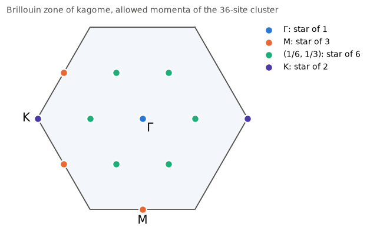
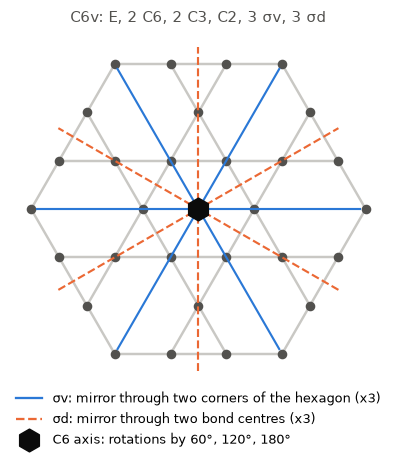
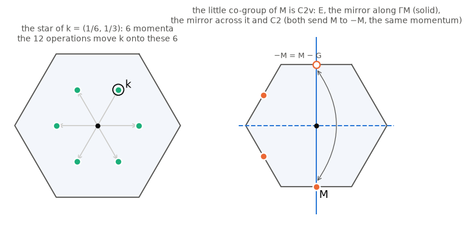

# Reading the symmetry output

`cc.symmetry(result).summary()` prints lines like these, for the 36-site kagome cluster in [`examples/clusters/`](../examples/clusters):

```text
  12 momenta in 4 stars, k in reciprocal primitive vectors:
    name  k           star  little co-group  irreps, (dimension) if not 1
    Γ     (0, 0)         1  C6v              A1 A2 B1 B2 E1(2) E2(2)
    M     (0, 1/2)       3  C2v              A1 A2 B1 B2
          (1/6, 1/3)     6  Cs               A' A"
    K     (1/3, 2/3)     2  C3v              A1 A2 E(2)
```

Each line ends in a list of *sectors*, written `momentum.irrep`: `Γ.A1`, `M.B2`, `K.E`. This page explains every word in that table, one idea per section, and ends with a worked example. The physics needs no more than linear algebra; standard references are listed at the end.

## 1. Crystal momentum

**Translations.** A translation T_c moves every site by c unit cells. It commutes with any Hamiltonian that has the same bonds in every unit cell, so energy eigenstates can be chosen as eigenstates of every T_c at once.

**Momentum.** Translations commute with each other, and doing T_c twice is T_{2c}. So the eigenvalue of T_c is a phase that is exponential in c. It is written e^{−ik·c}, and the vector k is the *crystal momentum* of the state. (clustercert's sign convention: the one-magnon state Σ_x e^{ik·x}|x⟩ has momentum k.)

**Why k is periodic.** Adding to k a vector G with e^{−iG·c} = 1 for every lattice vector c changes nothing. These G form the *reciprocal lattice*, spanned by the reciprocal primitive vectors b₁, b₂ (b_i·a_j = 2π if i = j, else 0). So k only matters modulo G. The *Brillouin zone* is one copy of every k: the k that are closer to k = 0 than to any other G. For kagome (and every hexagonal lattice) it is a hexagon.

**Why a cluster allows only some k.** On a cluster with periods T₁, T₂, the translation by a period is the identity, so e^{−ik·T} = 1 for every period. That leaves one allowed momentum per unit cell of the supercell. The 36-site kagome cluster has 12 unit cells, so 12 momenta:



clustercert writes k in units of b₁ and b₂: k = (1/6, 1/3) means k = b₁/6 + b₂/3.

**High-symmetry points.** Some momenta have names. Γ is always k = 0. The other names depend only on the type of Bravais lattice, and are the standard ones of band-structure plots ([Setyawan and Curtarolo, arXiv:1004.2974](https://arxiv.org/abs/1004.2974)):

| Bravais lattice | names | where |
|---|---|---|
| hexagonal (triangular, honeycomb, kagome) | K, M | corners and edge midpoints of the hexagonal zone |
| square (square, checkerboard) | X, M | edge midpoints and corners of the square zone |
| simple cubic | X, M, R | face centres, edge midpoints, corners of the cube |
| fcc (fcc, diamond, pyrochlore) | X, L, W, K | square face centres, hexagonal face centres, corners, edge midpoints |
| bcc | H, N, P | corners where four edges meet, face centres, corners where three meet |

clustercert recognises the Bravais type from the lattice's own rotations and its shortest translations, and a point by its distance from Γ and the number of rotations that keep it. A momentum without a name is written by its coordinates, `(1/6, 1/3)`. When two inequivalent stars (§3) of a cluster carry the same name, the coordinates are added: `X(0, 1/2, 1/2)` and `X(1/2, 0, 1/2)`.

## 2. Point groups and their names

**Point operations.** Besides translations, a lattice is symmetric under some rotations and reflections. The ones you will meet, with the names used in the output:

| name | operation |
|---|---|
| E | the identity |
| Cn | rotation by 360°/n about an axis (C2: 180°, C3: 120°, C4: 90°, C6: 60°) |
| σ | reflection in a mirror plane (in 2D: a mirror line) |
| i | inversion through a point, x → −x |
| Sn | rotation by 360°/n followed by the reflection in the plane perpendicular to the axis (S4, S6) |

**Point group.** The point operations of a lattice form its *point group*. The output names it with its Schoenflies symbol, which lists what it contains:

| symbol | operations | order | example |
|---|---|---:|---|
| C1 | E | 1 | a generic momentum |
| Cs | E, one mirror | 2 | a momentum on a mirror line |
| C2 | E, C2 | 2 | the 30-site kagome cluster |
| C2v | E, C2, two mirrors containing the axis | 4 | M on kagome |
| C3v | E, 2 C3, 3 mirrors | 6 | K on kagome |
| C4v | E, 2 C4, C2, 4 mirrors | 8 | square lattice |
| C6v | E, 2 C6, 2 C3, C2, 6 mirrors | 12 | triangular, honeycomb, kagome |
| D2h | three perpendicular C2 axes, three mirrors, i | 8 | |
| D3d | C3 axis, 3 perpendicular C2, i, 3 mirrors, 2 S6 | 12 | L on pyrochlore |
| D4h | C4 axis, 4 perpendicular C2, i, 5 mirrors, 2 S4 | 16 | X on pyrochlore |
| Td | the 24 symmetries of a tetrahedron | 24 | |
| Oh | the 48 symmetries of a cube | 48 | cubic, bcc, fcc, diamond, pyrochlore |

The letters: C (cyclic) means one rotation axis; D (dihedral) adds C2 axes perpendicular to it; v adds vertical mirrors (containing the axis); h adds the horizontal mirror (perpendicular to it); d adds diagonal mirrors between the C2 axes; T and O are the tetrahedral and octahedral (cubic) groups. A 2D lattice is treated as lying in a plane, with its rotation axis perpendicular to the plane; its mirror lines are then vertical mirror planes, so its point groups are the C_nv.



On kagome, the 12 operations of C6v all keep the centre of a hexagon fixed. The six mirrors come in two kinds (two *classes*): σv passes through two corners of the hexagon (lattice sites), σd through the midpoints of two bonds.

**Operations that need a translation.** The output lists operations as maps of fractional coordinates, x → Wx + t, about the origin of the unit cell (site 0). `C6 + (0, 1/2)` is a C6 about the origin followed by the translation a₂/2; together they are a C6 about a hexagon centre. On diamond and pyrochlore no single point is kept by every operation: some are a rotation or reflection *and* a fraction of a lattice vector (screw axes and glide planes). Such lattices are called *non-symmorphic*; the others are *symmorphic*.

**The cluster's point group.** A finite cluster keeps only the point operations that map its periods onto its periods. The 36-site kagome cluster keeps all 12 (C6v), the 24-site one with periods (2, 1), (−2, 3) keeps 4 (C2v), and the 30-site one with periods (5, 0), (1, 2) keeps 2 (C2).

## 3. Stars and little groups

**A point operation changes the momentum.** If g is a rotation and ψ has momentum k, then gψ has momentum gk (k rotated by g). Since g commutes with the Hamiltonian, ψ and gψ have the same energy.

**Stars.** The set of momenta {gk} reached from k by all point operations is the *star* of k. Every level found at k is also found, with the same energy, at every other momentum of its star. So exact diagonalization needs only one momentum per star: the first one in each row of the table.

**Little group.** Only the operations with gk = k (up to a reciprocal lattice vector G) map the momentum-k states among themselves. They form the *little co-group* of k; together with the translations they form the *little group* G_k. The orbit-counting rule ties the two together: |star| × |little co-group| = |point group|. On the 36-site kagome cluster: 1 × 12 at Γ, 3 × 4 at M, 6 × 2 at (1/6, 1/3), and 2 × 6 at K.



At M, the operations that keep M are the identity, the mirror along the line ΓM, the mirror across it, and C2. The last two send M to −M, which differs from M by a reciprocal lattice vector, so it is the same momentum. That is the group C2v.

## 4. Irreps and their names

**Irreps.** Inside the momentum-k block, each operation of the little group acts as a matrix. The states split into the smallest sets that these matrices never mix: the *irreducible representations*, or *irreps*. In an irrep of dimension d, the d states transform into combinations of each other. A Hamiltonian with the symmetry cannot tell them apart, so its levels in that irrep are exactly d-fold degenerate. 2- and 3-dimensional irreps force exact degeneracies; 1-dimensional ones do not.

**Characters.** The *character* χ(g) of an irrep is the trace of the matrix of g. Characters do not depend on the choice of basis, and they identify the irrep. For example, the character table of C3v (E, two C3 rotations, three mirrors):

| C3v | E | 2 C3 | 3 σv |
|---|---:|---:|---:|
| A1 | 1 | 1 | 1 |
| A2 | 1 | 1 | −1 |
| E | 2 | −1 | 0 |

**Worked example: three sites of a triangle.** Put amplitudes ψ₁, ψ₂, ψ₃ on the corners of a triangle. A rotation permutes the corners cyclically, a mirror keeps one corner and swaps two. The character of a permutation is its number of fixed corners: χ(E) = 3, χ(C3) = 0, χ(σv) = 1. The number of times an irrep ρ occurs is (1/|G|) Σ_g χ_ρ(g)* χ(g):
- A1: (3·1 + 2·0·1 + 3·1·1)/6 = 1. This is the symmetric state (1, 1, 1).
- A2: (3 + 0 − 3)/6 = 0.
- E: (3·2 + 2·0·(−1) + 3·1·0)/6 = 1. These are the two states orthogonal to (1, 1, 1), for example (2, −1, −1) and (0, 1, −1). A rotation turns each into a combination of both, so they always have the same energy.

clustercert does exactly this, with the permutations of your sites in place of the corners of a triangle.

**Mulliken names.** Irreps of the standard point groups have names that say how they transform:

| part | meaning |
|---|---|
| A, B | 1-dimensional; A is symmetric (character +1) under the main rotation axis, B antisymmetric (−1) |
| E, T | 2-dimensional, 3-dimensional |
| subscript 1, 2 | symmetric (1) or antisymmetric (2) under the reference C2 perpendicular to the main axis or, if there is none, the reference vertical mirror |
| E1, E2 (C6v, D6h) | χ(C6) = +1 for E1, which transforms like (x, y), and −1 for E2, which transforms like (x² − y², xy) |
| T1, T2 (cubic) | χ = +1 (T1) or −1 (T2) under C4 (or under S4 in Td) |
| g, u | even (gerade) or odd (ungerade) under inversion |
| ′, ″ | symmetric or antisymmetric under the horizontal mirror, in groups without inversion; also the two irreps of Cs |

The character table of C2v (E, C2, the reference mirror σv, the other mirror σv′):

| C2v | E | C2 | σv | σv′ |
|---|---:|---:|---:|---:|
| A1 | 1 | 1 | 1 | 1 |
| A2 | 1 | 1 | −1 | −1 |
| B1 | 1 | −1 | 1 | −1 |
| B2 | 1 | −1 | −1 | 1 |

Which mirror is the reference is a convention, and books differ. clustercert takes the one that contains the Cartesian x axis, or is closest to it (for D_n: the C2 axis closest to x). On the built-in 2D lattices, x is along the first primitive vector a₁, so on kagome the reference σv passes through lattice sites (the solid lines in the C6v figure). Exchanging the convention exchanges B1 and B2, and nothing else.

**Where the rotations are centred.** At Γ the name of an irrep is unambiguous. At other momenta the characters of the rotations depend on which point they rotate about: moving the centre multiplies them by a phase e^{−ik·c}. clustercert names irreps with the rotations taken about the most symmetric point that every operation of the little co-group keeps fixed, such as the hexagon centre on kagome or a site on the square lattice. About a different centre, A and B can be exchanged.

**Numbered irreps.** When there is no such point (non-symmorphic lattices away from Γ), or when the irrep is one of a pair of complex conjugate 1-dimensional irreps (the cyclic groups C3, C4, C6 and the group T), there is no standard Mulliken name. The irreps are then numbered, 1-dimensional ones first: `1`, `2`, …, with the dimension in brackets in the table. For example, at the X point of diamond and pyrochlore every irrep is 2-dimensional, `1(2) 2(2) 3(2) 4(2)`: non-symmorphic operations force every level there to be at least doubly degenerate. The characters are always available as `sector.characters`, whatever the name.

## 5. Reading a sector label

A sector label is `momentum.irrep`:

| label | read as |
|---|---|
| `Γ.A1` | momentum 0, fully symmetric under every point operation. Ground states are often here. |
| `M.B2` | momentum M (one of a star of 3), antisymmetric under C2 and under the reference mirror |
| `K.E` | momentum K (star of 2), 2-dimensional irrep of C3v: every level is 2 × 2 = 4-fold degenerate |
| `(1/6, 1/3).A"` | a momentum without a name (star of 6), odd under the one mirror that keeps it |
| `X.3` | the third irrep (numbered, see above) at an X point |
| `Γ.A1+` | with `spin_flip=True`: also even (+) or odd (−) under flipping every spin, a symmetry at zero magnetization |

**Degeneracy.** A level in sector (k, ρ) appears once for each momentum of the star and d times for each, so it is (|star| × d)-fold degenerate in the full spectrum. Levels of different sectors can also coincide by accident, or because the bond graph has symmetries that are not lattice symmetries; the summary says when the second can happen.

**Block size.** `block_sizes(n_up)` gives, per sector, the number of times its irrep occurs among the states with `n_up` up spins. That is the size of the Hamiltonian matrix you diagonalize in that sector when you keep one momentum per star and one row of each irrep.

## 6. Worked example: one flipped spin on the 36-site kagome cluster

Start from the bond list, the only input:

```python
import clustercert as cc

edges = cc.read_edges('examples/clusters/kagome_36.txt')
sym = cc.symmetry(cc.certify(edges, 'kagome'))
print(sym.summary(n_up=1))
```

The table at the top of this page is printed, followed by

```text
  block sizes (n_up = 1; each level is (star x dimension)-fold degenerate):
    Γ: A1 1, A2 0, B1 0, B2 0, E1 0, E2 1
    M: A1 1, A2 0, B1 1, B2 1
    (1/6, 1/3): A' 2, A" 1
    K: A1 1, A2 0, E 1
```

Read it as follows. With one up spin there are 36 states, 3 per momentum (one per sublattice). Symmetry sorts them:
- At Γ, the three sublattice states split into A1 (the uniform sum, 1 state) and E2 (2 states). The E2 pair is degenerate whatever the Hamiltonian, as long as it has the symmetry.
- At each M, the three split into A1 + B1 + B2: no degeneracy is forced.
- At K, into A1 + E.
- Counting with degeneracies gives back all 36: (1 + 2) + 3 × 3 + 6 × 3 + 2 × (1 + 2) = 36.

For the Heisenberg model H = J Σ S_i·S_j on these bonds, the energies relative to the fully polarized state, in units of J, are:

| sector | Γ.A1 | Γ.E2 | M.A1 | M.B1 | M.B2 | (1/6, 1/3).A′ | (1/6, 1/3).A″ | K.A1 | K.E |
|---|---|---|---|---|---|---|---|---|---|
| energies | 0 | −3 | −2 | −3 | −1 | −3, −0.5 | −2.5 | −3 | −1.5 |
| copies | 1 | 2 | 3 | 3 | 3 | 6 | 6 | 2 | 4 |

The level at −3 appears in Γ.E2, M.B1, (1/6, 1/3).A′ and K.A1: 2 + 3 + 6 + 2 = 13 states. This is kagome's flat magnon band, one state per unit cell (12), plus one more at Γ. The extra state is the E2 partner: the symmetry forces the flat band and the dispersive band to touch at Γ. The Γ.A1 state at energy 0 is the uniform spin rotation of the polarized state, which costs nothing.

## References

* C. J. Bradley and A. P. Cracknell, *The Mathematical Theory of Symmetry in Solids* (Oxford, 1972). Space groups, stars, little groups and their irreps, including non-symmorphic ones.
* M. Tinkham, *Group Theory and Quantum Mechanics* (McGraw-Hill, 1964). Characters, character tables and their use.
* M. S. Dresselhaus, G. Dresselhaus and A. Jorio, *Group Theory: Application to the Physics of Condensed Matter* (Springer, 2008). Point groups, Mulliken names and band-structure labels.
* R. S. Mulliken, *Report on notation for the spectra of polyatomic molecules*, J. Chem. Phys. 23, 1997 (1955). The A/B/E/T naming.
* W. Setyawan and S. Curtarolo, *High-throughput electronic band structure calculations: challenges and tools*, [arXiv:1004.2974](https://arxiv.org/abs/1004.2974); [Comput. Mater. Sci. 49, 299 (2010)](https://doi.org/10.1016/j.commatsci.2010.05.010). Names of high-symmetry momenta.
* A. Wietek and A. M. Läuchli, *Sublattice coding algorithm and distributed memory parallelization for large-scale exact diagonalizations of quantum many-body systems*, [arXiv:1804.05028](https://arxiv.org/abs/1804.05028); [Phys. Rev. E 98, 033309 (2018)](https://doi.org/10.1103/PhysRevE.98.033309). Symmetry-adapted bases for exact diagonalization.
